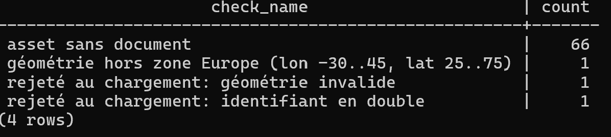
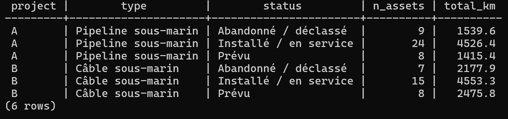

# Mini-archive PostGIS multi-projets

Projet personnel : une base PostgreSQL/PostGIS qui centralise des ouvrages sous-marins issus de **deux projets aux structures différentes**, comme une archive de géodatabases projets.

> Les données sont **fictives** (générées par `gen_data.py`, graine fixe) : tracés plausibles en mer du Nord et en Méditerranée, avec des anomalies introduites volontairement (doublon, géométrie dégénérée, objet hors zone) pour tester les contrôles qualité.

## Modèle de données
- `ref.*` : référentiels (types d'ouvrage, statuts) ; `archive.*` : projets, ouvrages, documents, table de liaison ; `staging.*` : données brutes de chaque projet ; `qc.*` : contrôles qualité.
- Clés primaires/étrangères (`ON DELETE RESTRICT` / `CASCADE` selon le cas), contraintes `CHECK`, `NOT NULL`, `UNIQUE (project_id, source_id)`.
- Géométrie `LineString` en EPSG:4326, avec contrainte `ST_IsValid`, index GIST.
- Table de liaison N-N `asset_document`.

## Pipeline
| Script | Rôle |
|---|---|
| `sql/01_schema.sql` | schémas, tables, contraintes, index |
| `sql/02_load.sql` | chargement CSV en staging, mapping des deux structures vers le modèle cible, journal des rejets |
| `sql/03_views.sql` | vues de détail et de synthèse (longueurs en km via `geography`) |
| `sql/04_qc.sql` | contrôles : doublons, géométries invalides, hors zone, ouvrages sans document |
| `sql/05_perf.sql` | `EXPLAIN ANALYZE` avec et sans index spatial (200 000 lignes) |
| `sql/06_data_dictionary.sql` | commentaires + export du dictionnaire (`docs/data_dictionary.csv`) |

## Résultats

**Contrôles qualité** (`qc.v_issues`) : 3 anomalies volontaires détectées et isolées (1 doublon et 1 géométrie invalide rejetés au chargement, 1 objet hors zone signalé) et 66 ouvrages sans document rattaché.



**Vue de synthèse** : deux sources de structures différentes unifiées dans un seul modèle, longueurs calculées en km via `geography`.



**Performance** : sur 200 000 ouvrages, une requête par emprise passe de **~54 ms (Seq Scan) à ~1,9 ms (Bitmap Index Scan)** grâce à l'index GIST, soit un gain d'un facteur ~28 (`sql/05_perf.sql`).

## Lancer le projet (Docker)
```powershell
docker cp . archive:/work
docker exec archive psql -U postgres -c "CREATE DATABASE surf_archive"
docker exec -w /work archive psql -U postgres -d surf_archive -f sql/01_schema.sql
docker exec -w /work archive psql -U postgres -d surf_archive -f sql/02_load.sql
docker exec -w /work archive psql -U postgres -d surf_archive -f sql/03_views.sql
docker exec -w /work archive psql -U postgres -d surf_archive -f sql/04_qc.sql
docker exec -w /work archive psql -U postgres -d surf_archive -f sql/05_perf.sql
docker exec -w /work archive psql -U postgres -d surf_archive -f sql/06_data_dictionary.sql
docker cp archive:/work/docs/data_dictionary.csv docs/
```

## Pistes d'amélioration
Connexion depuis ArcGIS Pro, script Python (psycopg2) pour les contrôles qualité, remplacement des données fictives par une couche réelle (EMODnet Human Activities).
